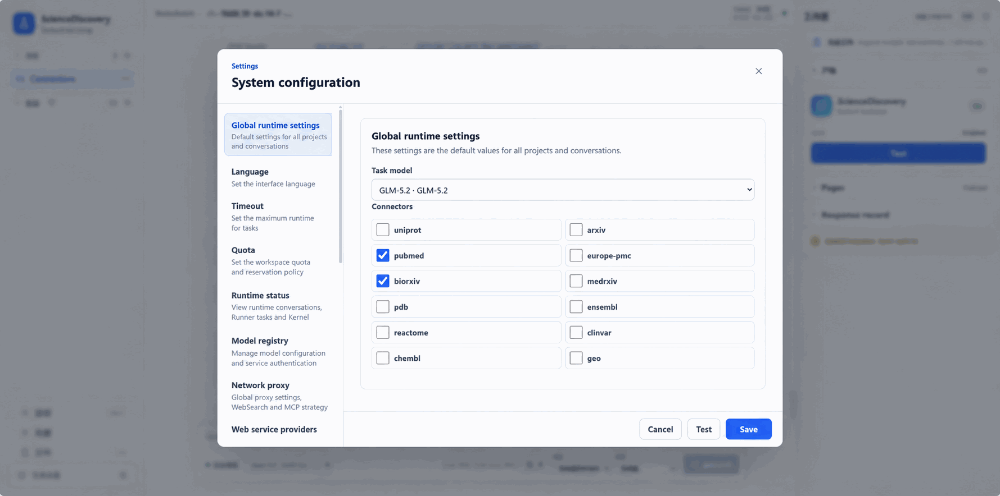
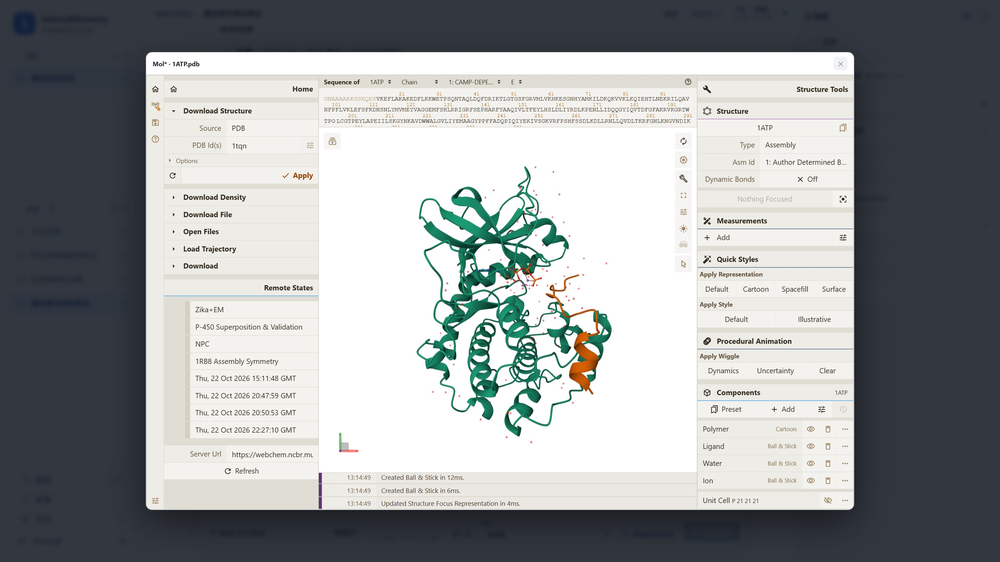
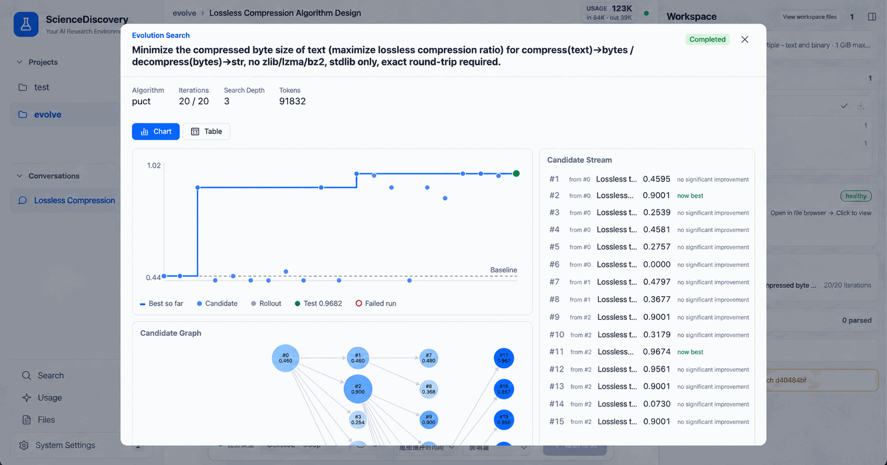
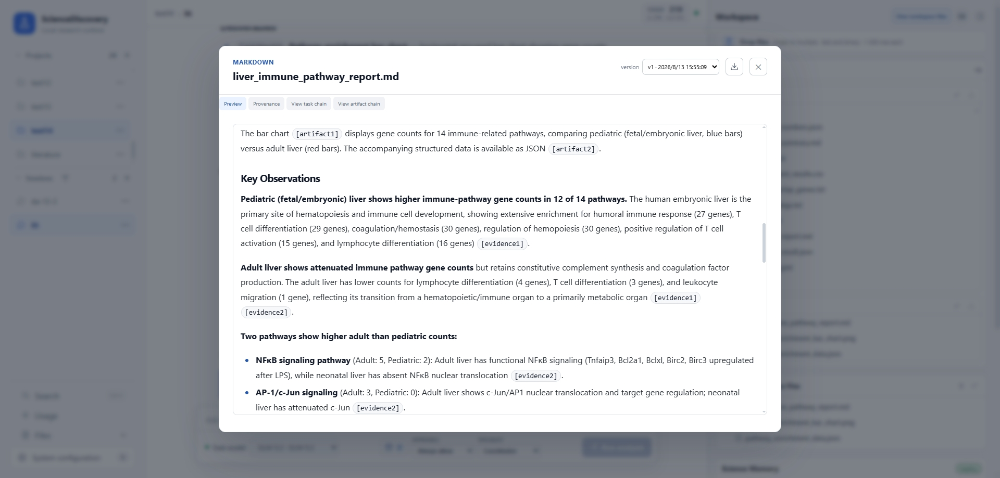

<div align="center">


# ScienceDiscovery

**The all-in-one AI research workspace built for science.** · [Visit the official website →](https://sciencediscovery.github.io/index.html)

Read the literature, form hypotheses, write and run code, conduct experiments, and tune parameters — all in one place. Every step leaves a record, and every result is traceable.

[](https://github.com/openJiuwen-ai/sciencediscovery/releases/tag/v0.3.0)
[](LICENSE)
[](#requirements)
[](https://sciencediscovery.github.io/docs/)

English · [简体中文](README_zh.md)

[Download](#quick-start) · [Product tour](#product-tour) · [Documentation](https://sciencediscovery.github.io/docs/) · [Contributing](CONTRIBUTING.md) · [Get slides](https://github.com/ScienceDiscovery/sciencediscovery.github.io/blob/main/site/src/media/ScienceDiscovery-Slides.pdf)

<a href="https://github.com/ScienceDiscovery/sciencediscovery.github.io/blob/main/site/src/media/demo.gif"></a>

</div>

## Why ScienceDiscovery

ScienceDiscovery runs locally: the agent reads the literature, writes and runs code, and delivers reports, tables, and figures, while the workspace keeps every result together with the evidence behind it.

- **Scientific MCP: one place for your scattered research tools.** Papers and data are retrieved and downloaded through Scientific MCP — no code to write, no API keys to wire up, no hopping between a dozen websites. Say what you need and the files land in your workspace.
- **Protein 3D structures, one click away.** Drop a PDB file into the workspace and the artifact preview opens an interactive 3D structure: rotate, zoom, a sequence panel, and protein, pocket and ligand atoms colored automatically by layer (the built-in Mol* viewer).
- **Self-evolving artifacts (RSI): auto-tune with fewer tokens.** Hand over something measurable — a program, a parameter table, even a prompt — and it generates variants, scores each one, validates the winner on held-out data and returns the best version. Every variant keeps its code, score and run record, so you can roll back.
- **Result provenance: trace any result back to its source.** Runs, artifacts and claims all carry their version and provenance: open a claim and see which run, which dataset and which code produced it, along with the inputs and outputs from that moment.
- **A research environment that runs locally.** ScienceDiscovery runs locally against your own files, and model keys stay on your machine. Python, R, and shell run inside a sandbox, scientific environments are provisioned and pinned for you, and long analyses keep running in the background. Connect a preset provider or any compatible endpoint — requests go only to the provider you configure.

## Product Tour

### 1. Flexible MCP selection: plug in what you need

Enable scientific MCP connectors on demand in System settings — PubMed, arXiv, Europe PMC, PDB, UniProt, Reactome and more — or add your own MCP servers. Tools join the same session, with permissions and governance applied.



### 2. View protein 3D structures in place

Drop a PDB file into the workspace and the artifact preview opens an interactive 3D structure: rotate, zoom, a sequence panel, with protein, pocket and ligand atoms colored automatically by layer.



### 3. Self-evolving artifacts: auto-tune and keep the trail

Hand over something measurable — a program, a parameter table, even a prompt — and it generates variants, scores each one, validates the winner on held-out data and returns the best version; every variant keeps its code, score and run record, so you can roll back.



### 4. Trace every artifact: click to inspect

Runs, artifacts and claims all carry their version and provenance: open the artifact's Provenance tab to see which run, dataset and code produced the result, along with the inputs and outputs from that run.



## Quick Start

### Windows — desktop app

1. Download the Windows installer (`.exe`) from the [Releases page](https://github.com/openJiuwen-ai/sciencediscovery/releases), then run it. The app bundles its own scientific runtime — no Node.js, Python, or WSL setup is required.
2. On first launch, choose a workspace directory (about 5 GB of free space is recommended). The app prepares its runtime in the background; the first preparation can take several minutes.
3. Choose a model provider, add your API key, test the connection, and start using the app.

> The desktop app is the recommended path on Windows. Linux users run the same workspace in the browser, as described below.

### Linux — single-file binary

Download the `ScienceDiscovery-<version>-linux-x86_64` asset for x86_64 or the `ScienceDiscovery-<version>-linux-aarch64` asset for arm64 from the [Releases page](https://github.com/openJiuwen-ai/sciencediscovery/releases), rename the downloaded file to `ScienceDiscovery`, then run:

```bash
chmod +x ./ScienceDiscovery
./ScienceDiscovery serve
```

Open <http://127.0.0.1:4310>. On the first connection, paste the local service access token from `.sciencediscovery-data/secrets/auth-token` into the **Connection** page — this works even when the service runs in the background. That token grants access to this machine's workspace, so keep it private. The same release page publishes `SHA256SUMS` for integrity verification.

### Connect a model

ScienceDiscovery does not bundle a model; you connect your own model API. On Linux, open **System configuration** at the bottom of the left sidebar, choose **Model registry**, select a preset provider or add one manually, enter its details and API key, then choose **Save & connect**. The first model also becomes the default task model; change it later under **Global default task model**. Protocol support and connection-check costs are documented in [Model API compatibility](docs/en/model-api-compatibility.md).

### Run your first task

Create a Project and a Session, drop a CSV or a PDF into the workspace, and describe the analysis you want. Approve the first execution when the permission card appears, follow tool calls and their results in the timeline, and open the files the task declares as **Artifacts** from the workspace panel.

## Capabilities

| Capability | What you get | Reference |
| --- | --- | --- |
| **Literature and data access** | Built-in connectors reach paper and data repositories; PDFs are parsed into citable evidence; custom MCP servers extend the catalog | [Literature research](https://sciencediscovery.github.io/docs/domains/literature-research.html) · [Custom MCP](https://sciencediscovery.github.io/docs/advanced-setup/configure-custom-mcp.html) |
| **Sandboxed execution** | The agent writes, debugs, and runs Python, R, and shell inside a fail-closed sandbox, with pinned managed environments and background tasks | [Sandbox execution](https://sciencediscovery.github.io/docs/developer-docs/sandbox-execution.html) |
| **Task decomposition and specialists** | Planning and multi-agent orchestration distribute work across sub-agents, Skills, and expert profiles | [Subagent orchestration](https://sciencediscovery.github.io/docs/developer-docs/subagent-orchestration.html) · [Skills](https://sciencediscovery.github.io/docs/developer-docs/skill-progressive-disclosure.html) |
| **Artifacts and end-to-end provenance** | Immutable artifact versions with producer code, inputs, environment inventory, and cited evidence; the optional memory graph makes the chain navigable | [Review and provenance](https://sciencediscovery.github.io/docs/developer-docs/review-provenance.html) · [ScienceMemory](https://sciencediscovery.github.io/docs/advanced-setup/science-memory-setup.html) |
| **Review and delivery checks** | Automatic review of a finished turn, including delivery completeness, with findings bound to the artifact version they reviewed | [Review and provenance](https://sciencediscovery.github.io/docs/developer-docs/review-provenance.html) |

## Evidence & Benchmarks

**BiomniBench-DA — 77.4 with GLM-5.2 (August 2026).** In this biomedical data-analysis benchmark, ScienceDiscovery scored 77.4. In the same media-reported comparison, Claude Code with Opus 4.7 scored 73.3 — the configuration the report labels as the previous industry SOTA — and Claude Code with GLM-5.2 scored 69.

| Configuration | BiomniBench-DA score |
| --- | --- |
| ScienceDiscovery + GLM-5.2 | **77.4** |
| Claude Code + Opus 4.7 (labelled the previous industry SOTA in the report) | 73.3 |
| Claude Code + GLM-5.2 | 69 |


The chart and scores come from the [published report](https://mp.weixin.qq.com/s/XSaX6oyok9qqZmwBUiQCFg) (Machine Heart, 2026-08-16) and describe the v0.1 release. The report does not state the dataset split, judge configuration, number of runs, or tested commit, so this page does not claim a score for any later release; re-measure before comparing across versions.

## Requirements

| Path | System requirements |
| --- | --- |
| **Windows desktop app** | Windows 10 or later on x64; about 5 GB of free disk space; no Node.js, Python, or WSL required |
| **Linux binary** | glibc-based Linux x86_64 or aarch64, including WSL 2; Bubblewrap 0.6+ with unprivileged user namespaces; no system Python, R, or conda required |

Managed scientific environments run on a pinned micromamba, so Python and R dependencies are prepared for you.

## Documentation

| Section | Guides |
| --- | --- |
| **Getting started** | [Quick start](https://sciencediscovery.github.io/docs/getting-started/quick-start.html) · [Deployment](https://sciencediscovery.github.io/docs/getting-started/deployment.html) |
| **Advanced setup** | [Custom MCP](https://sciencediscovery.github.io/docs/advanced-setup/configure-custom-mcp.html) · [Network proxy](https://sciencediscovery.github.io/docs/advanced-setup/configure-network-proxy.html) · [ScienceMemory](https://sciencediscovery.github.io/docs/advanced-setup/science-memory-setup.html) |
| **Reference** | [Configuration](https://sciencediscovery.github.io/docs/reference/configuration.html) · [REST API](https://sciencediscovery.github.io/docs/reference/rest-api.html) · [Built-in tools](https://sciencediscovery.github.io/docs/reference/builtin-tools.html) · [Runtime behavior](https://sciencediscovery.github.io/docs/reference/runtime-behavior.html) |
| **Developer documentation** | [Architecture](https://sciencediscovery.github.io/docs/developer-docs/architecture.html) and the [developer index](https://sciencediscovery.github.io/docs/developer-docs/) |

The complete English and Chinese indexes are on the [documentation site](https://sciencediscovery.github.io/docs/); development setup and test commands are in [CONTRIBUTING.md](CONTRIBUTING.md).

## Community

Join the ScienceDiscovery community on Slack or Feishu to ask questions, share results, and shape the roadmap.

| [Slack][slack-invite] | Feishu |
| :---: | :---: |
|  |  |

[slack-invite]: https://join.slack.com/t/sciencediscovery-hq/shared_invite/zt-4avv6fbom-uLrBalsUBR45N9sC2mGO~A

Bug reports and feature ideas are welcome on [GitHub Issues](https://github.com/openJiuwen-ai/sciencediscovery/issues), and contributions are described in [CONTRIBUTING.md](CONTRIBUTING.md). If ScienceDiscovery helps your work, a star on the repository helps more researchers find it.

## License

[Apache License 2.0](LICENSE). ScienceDiscovery is open source and self-hosted.

This product serves solely as a workflow orchestration tool and does not embed any AI model capabilities. When users integrate AI models for specific business scenarios, they shall bear full responsibility for compliance obligations under the EU AI Act and other relevant regulatory frameworks.
