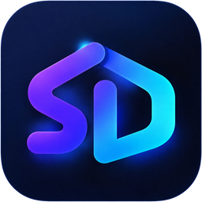
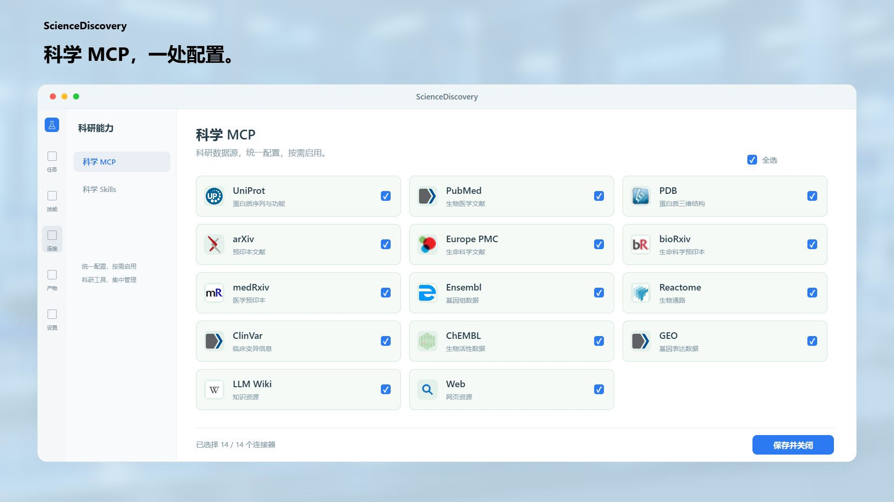
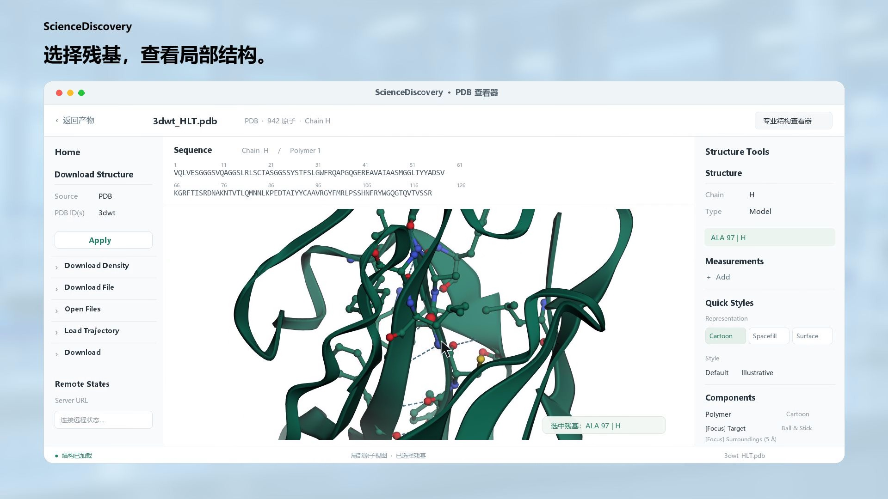
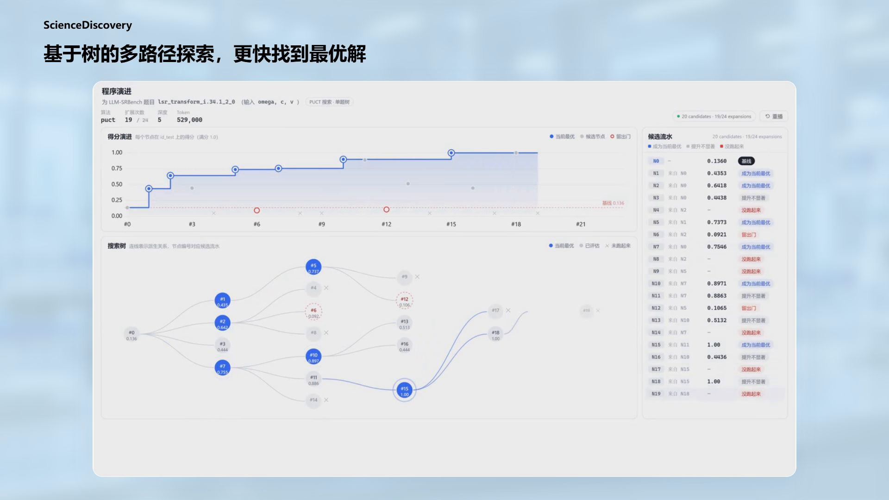
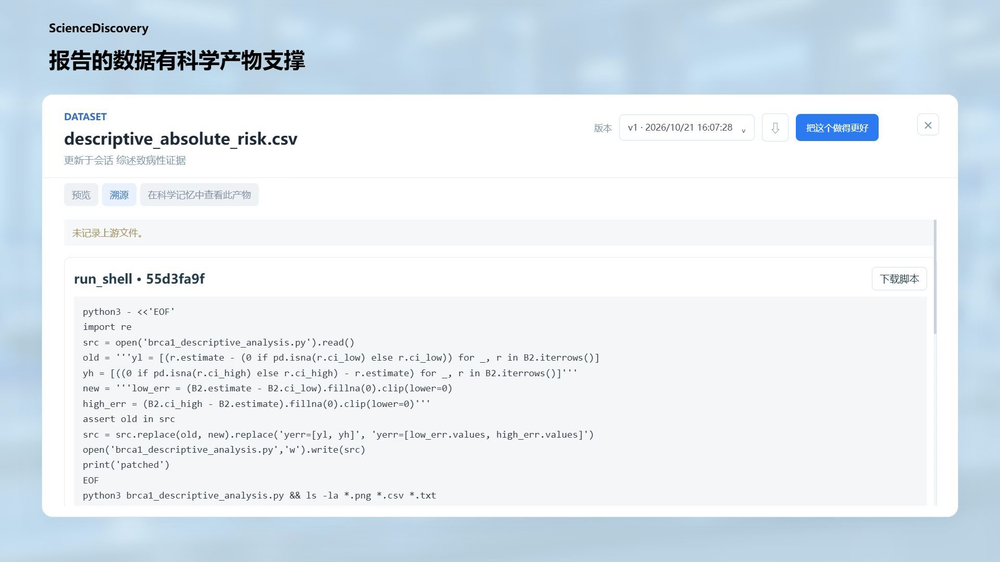
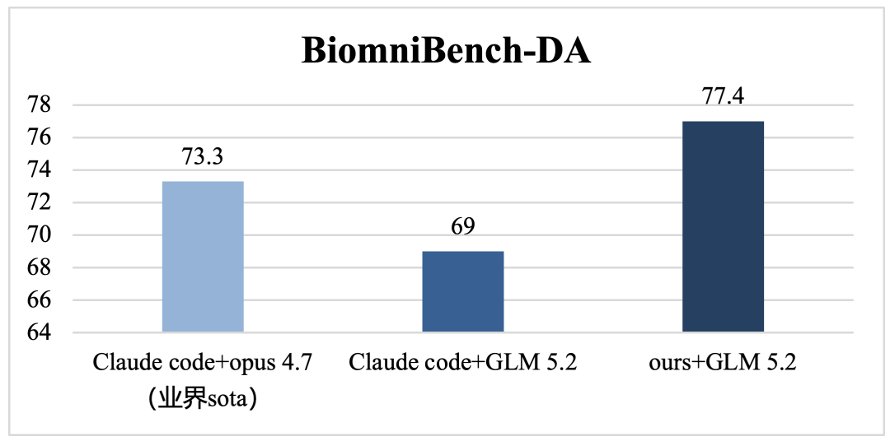

# ScienceDiscovery

**专为科研打造的一站式 AI 科研工作站。** · [前往官网 →](https://sciencediscovery.github.io/zh/index.html)

文献阅读、假设提出、代码编写、实验试错、参数调优 —— 一站式里完成，每一步都留痕，每一个结果都可溯源。

[English](README.md) · 简体中文

[下载](#快速开始) · [产品导览](#产品导览) · [文档](https://sciencediscovery.github.io/zh/docs/) · [贡献指南](CONTRIBUTING.md) · [获取 Slides](https://github.com/ScienceDiscovery/sciencediscovery.github.io/blob/main/site/src/media/ScienceDiscovery-Slides.pdf)

## 为什么选择 ScienceDiscovery

ScienceDiscovery 本地完成：智能体阅读文献、编写并运行代码、交付报告、表格与图表，工作区可以查看结果和支撑结果的证据。

- **科学 MCP：碎片化科研工具，一站式接入。** 文献与数据通过科学 MCP 检索、下载：不用写代码、不用配 API key，也不用在十几个网站之间手动翻找；说清你要什么，文件直接落到工作区。
- **蛋白质 3D 结构，点开即看。** 把 PDB 文件放进工作区，在产物预览页就能打开交互式 3D 结构：旋转、缩放、序列面板，蛋白、口袋与配体自动分层着色（内嵌 Mol* 查看器）。
- **产物自进化：自动调优，消耗更少 token。** 给出一个可评价的产物——程序、参数表甚至提示词都行——它会成批生成变体、逐个打分，用留出数据检验，最后把得分最高的版本交给你；每个变体的代码、分数与运行记录都保留版本，随时可以回退。
- **结果可溯源：数据、代码、运行记录层层可查。** 运行、产物与结论都带版本和来源：这条结论出自哪次运行、哪份数据、哪段代码，点开就能看到当时的输入与输出。
- **可以本地运行的科研环境。** ScienceDiscovery 在本地运行，直接读写你自己的文件，模型密钥也保存在本机。Python、R 与 Shell 在沙箱内执行，科研环境按固定版本自动准备，长任务在后台持续运行；连接预设提供方或任意兼容端点，请求只会发往你配置的模型服务。

## 产品导览

### 1. 灵活选择 MCP：按需接入科研工具

在系统设置里按需启用科学 MCP 连接器——PubMed、arXiv、Europe PMC、PDB、UniProt、Reactome 等——也可以添加自定义 MCP 服务器；工具带着权限与治理进入同一套会话，随用随开。

### 2. 查看 3D 蛋白质结构：把 PDB 放进对话

把 PDB 文件放进工作区，产物预览页点开就是交互式 3D 结构：旋转、缩放、序列面板，蛋白、口袋与配体自动分层着色；选中残基还能查看局部结构。

### 3. 科研产物自进化：自动调优，保留过程

给出可评价的产物（程序、参数表甚至提示词），它会成批生成变体、逐个打分、用留出数据检验，交付得分最高的版本；每个变体的代码、分数与运行记录都保留，随时可回退。

### 4. 科研产物可追溯：点开就能核对

运行、产物与结论都带版本和来源：这条结论出自哪次运行、哪份数据、哪段代码，打开产物的「溯源」即可看到当时的输入与输出。

## 评测结果

**BiomniBench-DA — 77.4（GLM-5.2，2026 年 8 月）。** 在生物医学数据分析基准中，ScienceDiscovery 取得 77.4 分。在同一篇媒体报道的对比中，Claude Code + Opus 4.7 为 73.3（报道称之为此前的业界 SOTA），Claude Code + GLM-5.2 为 69。

| 配置 | BiomniBench-DA 得分 |
| --- | --- |
| ScienceDiscovery + GLM-5.2 | **77.4** |
| Claude Code + Opus 4.7（报道中标注为此前的业界 SOTA） | 73.3 |
| Claude Code + GLM-5.2 | 69 |

图表与分数来自[公开报道](https://mp.weixin.qq.com/s/XSaX6oyok9qqZmwBUiQCFg)（机器之心，2026-08-16）。

## 快速开始

当前支持 Windows 和 Linux 两个版本，可以从 [Releases 页面](https://github.com/openJiuwen-ai/sciencediscovery/releases) 下载 Windows 安装包 `ScienceDiscovery-<version>-win-x64-setup.exe`，以及 Linux 执行程序 `ScienceDiscovery-<version>-linux-x86_64`（x86_64）或 `ScienceDiscovery-<version>-linux-aarch64`（arm64）二进制；详细的安装与启动步骤见[官网安装指导](https://sciencediscovery.github.io/zh/docs/getting-started/deployment.html)。

### 连接模型

ScienceDiscovery 不内置模型，需要接入你自己的 API。在 Linux 下，打开左侧栏底部的 **系统配置（System configuration）**，进入 **模型库（Model registry）**，选择预设提供方或手动添加，填写服务信息与 API Key，然后点击 **保存并连接（Save & connect）**。第一个模型同时会成为默认任务模型，之后可在 **全局默认任务模型** 中修改。协议支持范围与连接测试的费用说明见 [模型 API 兼容性](docs/zh/model-api-compatibility.md)。

### 运行第一个任务

新建项目与会话，将 CSV 或 PDF 拖入工作区，描述你希望完成的分析。权限卡出现时批准首次执行，在时间线中跟踪工具调用与结果，并从工作区面板打开任务声明为**产物（Artifacts）**的文件。

## 系统要求

| 使用方式 | 系统要求 |
| --- | --- |
| **Windows 桌面端** | Windows 10 及以上版本，x64；约 5 GB 可用磁盘空间；无需 Node.js、Python 或 WSL |
| **Linux 二进制** | 基于 glibc 的 Linux x86_64 或 aarch64（含 WSL 2）；Bubblewrap 0.6+ 与免特权用户命名空间；无需系统 Python、R 或 conda |

科研环境由固定版本的 micromamba 统一准备，Python 与 R 依赖无需自行配置。

## 社区

欢迎加入 ScienceDiscovery 的 Slack 或飞书社区，提问、分享结果，一起决定产品方向。

| [Slack][slack-invite] | 飞书 |
| :---: | :---: |
|  |  |

[slack-invite]: https://join.slack.com/t/sciencediscovery-hq/shared_invite/zt-4avv6fbom-uLrBalsUBR45N9sC2mGO~A

问题反馈与功能建议请提交到 [GitHub Issues](https://github.com/openJiuwen-ai/sciencediscovery/issues)，贡献流程见 [CONTRIBUTING.md](CONTRIBUTING.md)。如果 ScienceDiscovery 对你的研究有帮助，欢迎点一个 Star，让更多研究者发现它。

## 许可证

[Apache License 2.0](LICENSE)。ScienceDiscovery 是开源、自托管的工作区。

本产品仅作为工作流编排工具，不内置任何 AI 模型能力。用户将 AI 模型接入具体业务场景时，须自行承担《欧盟人工智能法案》（EU AI Act）及其他相关监管框架下的合规责任。
