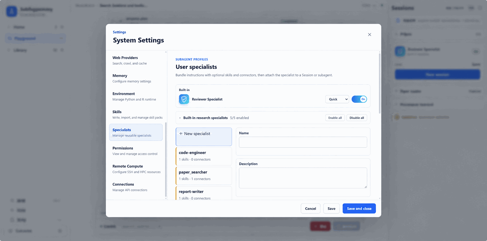

# Specialists: give research tasks focused expertise

A research report often requires several kinds of work: finding papers, extracting evidence, writing code, evaluating results, and developing an argument. Each needs different judgment. Retrieval should fill source gaps; writing should avoid adding unsupported findings. Someone implementing an analysis also benefits from a separate examination of methodology and reliability.

Specialists separate these responsibilities and supply role instructions, Skills, and tool scope. The main Agent can choose roles suited to the task while retaining responsibility for the research objective and synthesis. Researchers spend less time repeating working requirements and gain clearer assignments and deliveries.

The relationship to MCP and Skills is simple: **MCP is a tool, Skill is a method, and Specialist is a role.** By default a Specialist uses the native model loop; it packages who owns a kind of work, which methods they can use, and which tools they can call.

## Preset roles are a starting point

ScienceDiscovery provides preset Specialists for literature retrieval, evidence extraction, code analysis, result evaluation, report writing, and selected material-design work. Combine them as needed; every investigation does not require a full team.

For a bird-migration review, retrieval can prepare sources, evidence extraction can preserve species and experimental conditions, and writing can synthesize the findings. Data analysis may benefit more from separating code implementation and result evaluation.

The complete preset inventory changes with releases; see [Built-in research capabilities reference](../reference/builtin-research-capabilities.md).



Preset responsibilities can be enabled or disabled. Role names do not confer professional qualifications, and several roles may share model biases. Clear assignments support inspection rather than replace validation. The workflow's `result-evaluator` is also distinct from the artifact-focused [Reviewer mechanism](science-memory-reviewer.md).

## Bring in your domain's experience

Presets cannot cover every laboratory's process. Create a Specialist that captures your research scope, decision rules, delivery requirements, and available connectors. A cohort-selection assistant, for example, could require inclusion/exclusion counts at each step and reproducible scripts.

Custom roles use the existing runtime and permission system; adding one does not require redeploying the application. If a role needs specialized tools or methods, connect MCP services or import Skills and incorporate them into the appropriate workflow.

- [Create and use custom Specialists](../advanced-setup/configure-specialists.md): define responsibilities, configure resources, and verify a task.
- [Scientific MCP and Skills](mcp-skills.md): existing tools, methods, and extension options.
- [Literature-research tutorial](../domains/literature-research.md): from a question to an inspectable report.

Explicit delegated tasks can opt into the [Codex Specialist runtime](../advanced-setup/configure-specialists.md#codex-specialist-runtime), while retaining platform Workspace, permissions and artifacts.

### Platform decision turns

Codex, Claude Code and ACP use the same structured decision contract:

```json
{"summary":"Check then run","tools":[{"tool":"run_shell","arguments":"{\"command\":\"pwd\"}"},{"tool":"run_shell","arguments":"{\"command\":\"ls\"}"}]}
```

`tools` is an ordered array; each `arguments` value is a JSON-encoded object
matching the named platform tool's schema. All calls are validated before any
call in that turn executes. Calls run serially, including exclusive tools,
through the existing platform permission, Runner and audit bindings. Results
for every call are returned in the next decision's history. Use
`{"summary":"Final answer","tools":[]}` to finish; a nonempty list always
requests work and its summary is not a final answer. Native shell/file tools
remain disabled. The main agent's parallel limits are unchanged.

Malformed JSON, unexpected fields, unknown tools and invalid arguments get
one correction request within the same decision turn. A second invalid output
fails explicitly without executing any part of that decision. Execution or
permission failures do not trigger this correction retry. The former singular
`tool`/`arguments` envelope is replaced by `tools`; runtime prompts and Codex's
output schema supply this contract automatically, with no runtime-kind tiers
or user configuration migration.

To verify the free-form brief / DSV-compatible endpoint improvement without
provider secrets, run:

```bash
pnpm build
pnpm exec tsx --test services/api/src/specialist-runtime/decisions.test.ts
```

The fixtures ask for two checks in a free-form brief. A valid two-call response
now succeeds on its first attempt (the former singular schema rejected it).
Malformed or mixed-intent responses followed by a corrected two-call response
complete instead of terminating on the first invalid output; two invalid
responses fail after exactly two attempts, with zero calls dispatched. These
are deterministic contract/recovery results, not a measured live-provider
failure rate. For a live DSV comparison, run the same saved brief set and model
settings before/after, record invalid first responses separately from terminal
`invalid platform decision` failures, and count correction successes and tool
calls in the platform audit. Do not enable native tools for either run.
