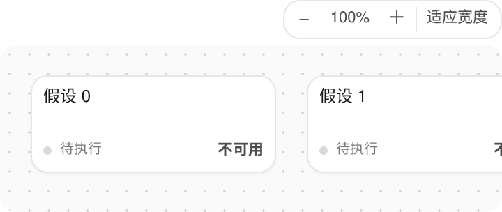
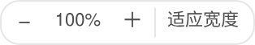

# Idea Tree zoom bar — contrast capture

Evidence for #1503, captured at the candidate that fixes the one required change
in the review of this pull request: `.idea-tree-zoom-level` and
`.idea-tree-zoom-fit` in `apps/desktop/src/styles/idea-tree.css` no longer paint
`var(--muted)` but `var(--text-secondary)`, so the bar's 11 px text clears the
WCAG AA 4.5:1 floor for normal text.

The zoom bar itself is the feature this pull request adds; these frames exist so
the colour of that bar can be confirmed from a render rather than from markup.

## How they were captured

- A harness in `apps/desktop/.tmp/zoom-a11y/render.tsx` (gitignored, not part of
  this branch) server-renders the real `apps/desktop/src/views/idea/IdeaTree.tsx`
  with `IdeaTreeView`, and puts the app's own `tokens.css` and `idea-tree.css`
  in the page — the two stylesheets `apps/desktop/src/styles/index.css` imports
  that paint this bar.
- Pinned Chromium (`Chromium 156.0.8078.108`), headless, viewport 400×700,
  `deviceScaleFactor: 2`, page 360 px wide — the column width the review
  measured. Each PNG is therefore twice the CSS size it shows.
- Colours are read back from the live page with `getComputedStyle`, and the
  contrast ratio is computed from those computed colours (WCAG relative
  luminance), not from the values in the stylesheet.

## What is mocked

The graph is fixture data written for this capture: six leaf nodes with
objective `目标` and one revision, wide enough that the column cannot show them
all. The page is static markup — no wheel, drag, double click or key press is
exercised here, so these frames show appearance only; the gestures, the scroll
behaviour and the fit control are covered by the desktop tests. No API, model
call or Electron shell is involved.

## What the frames show

| File | Locale | State |
| --- | --- | --- |
| `01-zh-zoom-bar-column.png` | zh-CN | The bar in the shell's header, above the drawing, at 100% — `−` `100%` `＋` `适应宽度` |
| `02-zh-zoom-bar-detail.png` | zh-CN | The same bar alone, so the two 11 px labels can be read at size |

In both frames the `100%` readout and `适应宽度` compute `rgb(77, 77, 77)`
(`#4d4d4d`) on the bar's `rgb(255, 255, 255)`: **8.45:1**, the same colour as
the `−` and `＋` buttons next to them. At the head the review looked at, both
labels were `rgb(119, 119, 119)` (`#777777`), 4.477:1 — a lighter grey than the
buttons, and under the floor.

These are review evidence, not product assets, and they stay on the branch so
the pull request's links keep resolving. They cover the zh column at 100%; they
do not cover the en locale, nor the 148% state after a sideways scroll.
