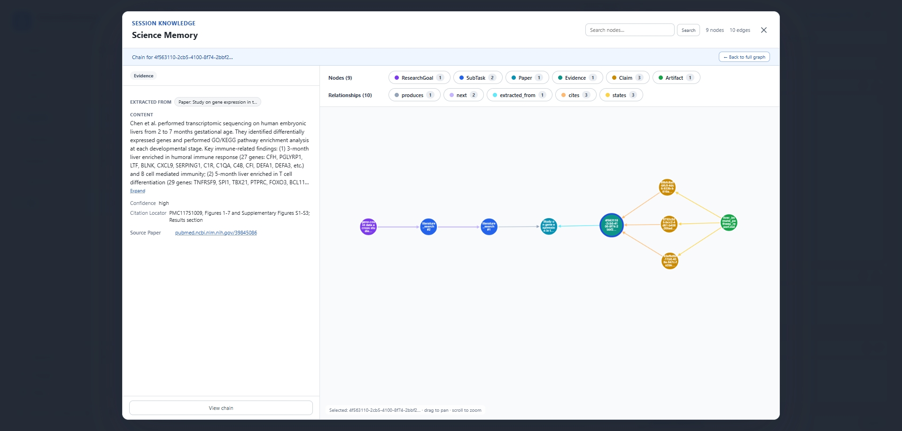

# 记忆图谱与 Reviewer：让结论经得起追问

读到一份流畅的报告，我们常常还需要问：“这个数字来自哪次计算？这句话引用的论文，真的支持它吗？”ScienceMemory 和 Reviewer 分别帮助保存研究依据、发现需要复核的问题，让检查工作有具体的落点。

## 把研究经过和论证依据连起来

ScienceMemory 将已记录的任务、工具调用、代码、文件和引用组织成可点击的图。任务链帮助查看做过什么、产生了什么；引用链帮助查看某条结论关联了哪些证据，以及这些证据来自哪里。

例如，一张分析图可以关联生成它的代码与执行记录；报告中的结构化引用可以通向证据或产物。比起只在聊天历史中寻找蛛丝马迹，研究者可以沿这些关系回到具体记录。

图的完整程度取决于实际记录与显式建立的证据关系。并非所有自然语言句子都会自动获得完整支撑链，未登记的依据也不会凭空出现在图中。

## 给产物增加一个检查视角

新安装默认启用 Reviewer 和会话自动审查。符合条件的报告产物会在同一工作流内触发后台评审，无需再次发送消息。输入框旁的 **自动审查** 可一键关闭当前会话的自动评审；工作区保留 **Run review** 和 Quick/Deep 设置。评审围绕具体产物版本留下问题与理由，帮助定位缺失引用、来源不匹配或计算溯源不完整等疑点。

Quick 侧重引用结构与计算证据链的检查。更深入的核查需要可访问的来源、相应工具与时间预算。引用格式正确，不等于原文支持论断；记录了执行过程，也不等于统计方法正确。

评审同时核对该任务自己声明的交付物。任务 Brief 写明必交文件时，评审逐个给出“存在 / 为空 / 缺失”，为空或缺失会阻止交付通过，并列出具体路径；任务没有声明必交文件时，评审明确说明“交付完整性未验证”，而不是显示通过——引用检查通过从不等于整体交付完成。文件存在只证明它存在，文件内容、生成它的计算以及科研结论都不在已验证范围内。

评审结论对应具体产物版本：同一产物出现新版本后，旧评审标为已过期并保留为历史，不再作为当前结论展示。自动审查开启时，新版本会进入审阅队列并在原位置更新；关闭时不会替用户打开，已有的评审入口照常可用。

Reviewer 的反馈不会自动改写产物，也不代表主 Agent 必然完成修订。你可以据此要求补充证据、收窄表述或修正计算，再查看新的产物版本。

## 降低幻觉，靠的是可检查的依据

这套机制的价值在于把“似乎不可信”变成可追踪的问题：缺少哪条来源，哪次计算与结果不一致，哪些结论超出了证据范围。它为降低科研幻觉提供支撑，但模型评审也可能误判，图谱本身不是真实性的证明。

科学记忆是可选能力。本地文件后端无需额外部署图数据库；需要 Neo4j 时再选择对应后端。已有的显式关闭设置会保留。系统能力关闭时，输入框旁会说明自动审查不可用的原因，符合条件的报告会留下跳过原因。先完成一次有可靠产物的分析，再逐步引入追溯与评审，通常更容易理解各项记录的意义。

- [科学记忆配置](../advanced-setup/science-memory-setup.md)：本地后端与 Neo4j。
- [评审与溯源设计](../developer-docs/review-provenance.md)：版本、证据与评审记录。
- [科学记忆设计](../developer-docs/science-memory.md)：任务链与引用链。

当前控制项是系统 Reviewer Specialist 开关与会话自动审查开关；旧字段 `reviewMode` 和 `semanticReviewEnabled` 不控制此路径。
