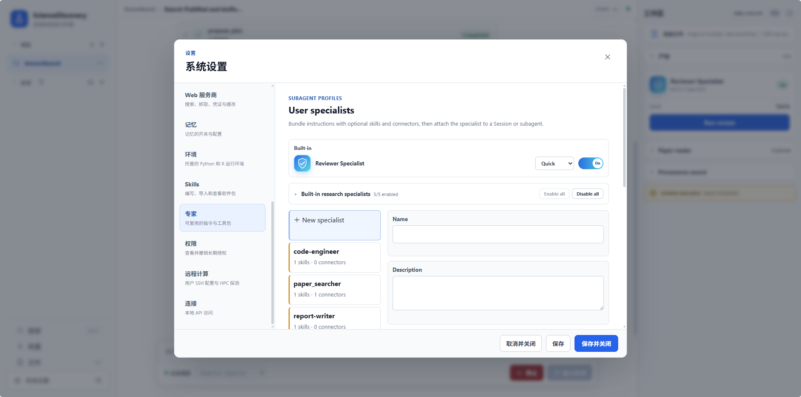

# 专业 Specialist：让科研任务各有专长

一份科研报告往往跨越几种工作：找文献、读证据、写代码、检查结果，再把发现组织成论述。它们需要不同的判断标准。检索时应尽量补齐来源，写报告时应克制新增未经核实的观点；负责实现分析的人，也需要有人从方法与可靠性的角度复核结果。

Specialist 将这些职责分开，并为每种角色准备指令、Skill 与工具范围。主 Agent 可以按任务需要调用合适的角色，把精力放在研究目标与综合判断上。对研究者而言，价值是减少重复交代工作要求，让分工和交付更清楚。

它和 MCP、Skill 的关系很直接：**MCP 是工具，Skill 是方法，Specialist 是角色。** Specialist 本身不是新的执行环境，而是把“谁负责什么、可以采用哪些方法、能调用哪些工具”组合成可复用的职责单元。

## 预置角色只是起点

ScienceDiscovery 提供若干预置 Specialist，覆盖文献检索、证据提取、代码分析、结果评价、报告撰写以及部分材料设计任务。它们可以按需组合，不要求每次研究都启动完整团队。

例如，鸟类迁徙调研可以先由检索角色整理来源，再由证据角色保留鸟种、实验条件和结论边界，最后综合成报告；数据分析则更适合代码实现与结果评价分工。

预置 Specialist 的完整清单会随版本演进，见[预置科研能力参考](../reference/builtin-research-capabilities.md)。



预置角色的职责可以启用或停用。角色名称不会带来专业资格，多个角色也可能共享模型偏差；清楚的分工帮助你检查过程，而不替代科研验证。`result-evaluator` 是研究流程中的结果评价角色，与面向产物的 [Reviewer 机制](science-memory-reviewer.md) 也不是同一个入口。

## 把你所在领域的经验接进来

预置角色不可能覆盖每个实验室的流程。你可以创建自己的 Specialist，把研究范围、判断规则、交付要求与可用连接器组织起来。例如，一位专门核查队列筛选的数据助手，可以要求逐步记录纳入排除人数，并交付可复现脚本。

自定义角色使用现有运行环境与权限体系，不需要为了增加一个角色重新部署整套系统。需要专用工具或方法时，可以先接入 MCP 或导入 Skill，再组合进适用的研究流程。

- [创建与使用自定义 Specialist](../advanced-setup/configure-specialists.md)：填写职责、配置资源并验证一次任务。
- [科研 MCP 与 Skill](mcp-skills.md)：查看已有工具与方法，以及扩展入口。
- [文献调研教程](../domains/literature-research.md)：从问题到可核查报告。

### 平台决策回合

Codex、Claude Code、ACP 统一使用多工具结构化决策：

```json
{"summary":"先检查再执行","tools":[{"tool":"run_shell","arguments":"{\"command\":\"pwd\"}"},{"tool":"run_shell","arguments":"{\"command\":\"ls\"}"}]}
```

`tools` 是有序数组，`arguments` 是符合对应平台工具参数 schema 的 JSON
对象字符串。整批校验通过后，所有工具（包括独占工具）按数组顺序串行执行，
继续经过平台权限、Runner 和审计绑定；下一次决策能看到每个工具的结果。
`{"summary":"最终答复","tools":[]}` 表示完成；非空列表始终表示请求执行。
不开放原生 shell 或文件修改，不调整主 Agent 的并行上限，也不按运行时分档。

非法 JSON、多余字段、未知工具或非法参数会在同一回合内纠错一次；第二次仍然
非法则明确失败，该决策中的工具均不执行。执行或权限失败不会触发纠错重试。
旧的单个 `tool`/`arguments` 外层结构替换为 `tools`，运行时提示和 Codex 输出
schema 自动提供新契约，用户配置无需迁移。

无密钥验证方法：先运行 `pnpm build`，再运行
`pnpm exec tsx --test services/api/src/specialist-runtime/decisions.test.ts`。
自由 brief 的双工具合法响应现在首次即可通过（旧 schema 会拒绝）；非法响应
经一次纠正后可完成，不再首败即终止；连续两次非法则零执行并明确失败。
这是确定性契约测试，不代表已测量真实供应商首败率。联调 DSV 时，可在改动前后
使用相同 brief 集合、模型和参数，分别统计首次非法响应、最终失败、纠错成功和
审计中的实际工具调用数，两组均保持原生工具禁用。
