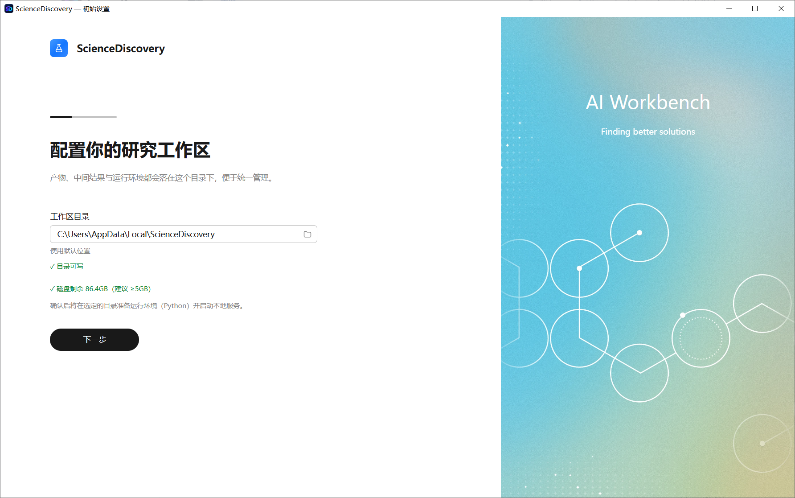
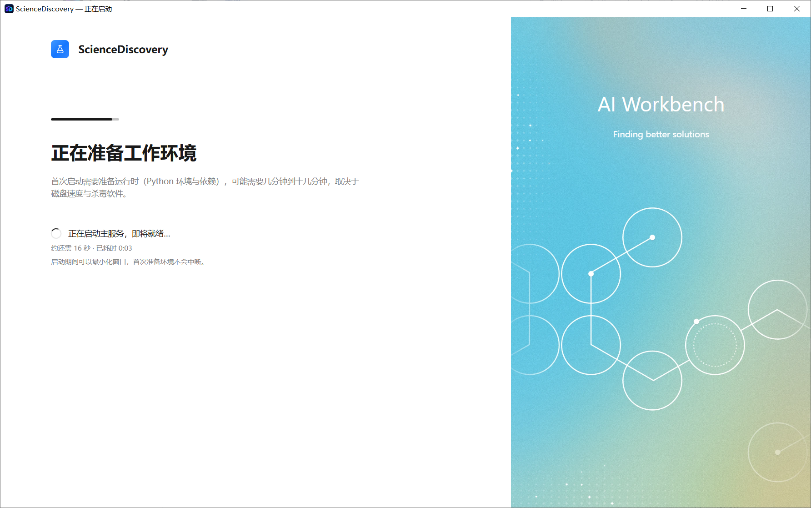
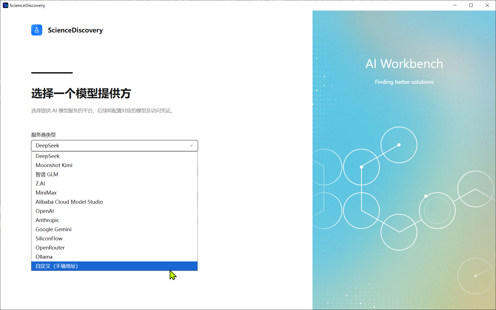
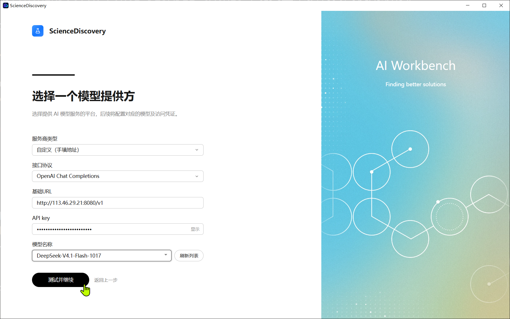
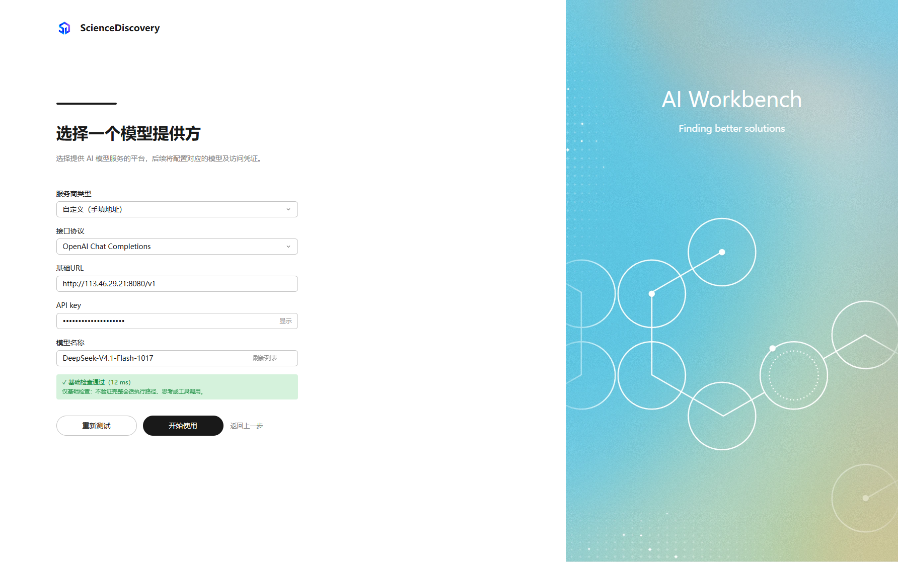
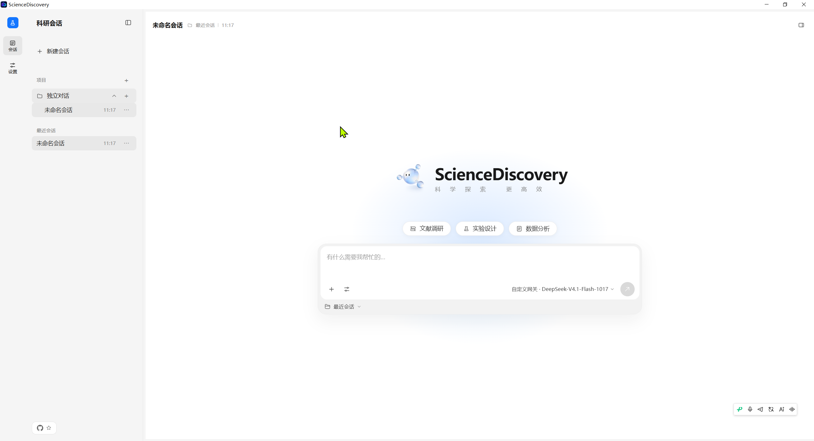

# 安装 ScienceDiscovery

Windows 使用桌面安装程序，装完之后双击就能用：不需要打开浏览器，也不需要手动粘贴本地服务访问令牌。

Linux 使用预编译单文件发行包：下载后在终端执行一条命令启动服务，再用浏览器打开界面。

## 前置条件

### Windows

- Windows x64；
- 安装目录约需 2.6 GB 空闲空间；
- 数据目录建议预留 5 GB 以上（首次启动会在其中准备 Python 运行时）；
- 至少一个模型服务商的 API Key。

### Linux

- 使用 glibc 的 Linux x86_64 或 aarch64；Alpine Linux 等使用 musl 的发行版不能直接运行此发行包；
- 内置 Node.js 运行时要求 glibc 2.28+，且需要兼容的 libstdc++；
- Bubblewrap 0.6+，推荐 0.8+，并允许非特权用户命名空间（Debian 11 自带的 0.4.1 版本过低）；
- 首次启动可访问互联网，用于准备运行依赖；
- 至少一个模型服务商的 API Key。

## Windows 首次启动设置

第一次启动是一个三屏的初始化向导，只需要走一次。

### 配置研究工作区

产物、中间结果和运行环境都会写在这里。默认目录是 `C:\Users\<你的用户名>\AppData\Local\ScienceDiscovery`，
下方会显示当前磁盘剩余空间，需要 ≥5 GB。确认 **目录可写** 后点击 **下一步**。



### 等待准备工作环境

首次启动要在数据目录中准备 Python 运行时和依赖，可能需要几分钟到十几分钟，取决于磁盘速度与杀毒软件。
中途可以最小化窗口，首次准备过程不会中断。



### 选择模型提供方

在 **服务商类型** 中选择预置服务商（DeepSeek、Moonshot Kimi、智谱 GLM、Z.AI、MiniMax、阿里云百炼、OpenAI、
Anthropic、Google Gemini、SiliconFlow、OpenRouter、Ollama 等）；如果要接自建或中转服务，选择
**自定义（手填地址）**，再填写 **接口协议**、**基础 URL**、**API key** 和 **模型名称**。
模型列表可以点 **刷新列表** 重新拉取。

填写完成后点击 **测试并继续**。





### 基础连接检查通过

测试通过后窗口会显示 **基础检查通过** 和耗时，并注明该基础检查仅确认服务商可应答最小请求，不验证完整会话执行路径、
思考或工具调用。点击 **开始使用** 进入主界面；如果失败，先核对 API Key、基础 URL 和模型名称，再点 **重新测试**。





## Linux 安装与启动

### 安装 Bubblewrap

```bash
sudo apt-get install -y bubblewrap   # Debian / Ubuntu
# 或
sudo dnf install -y bubblewrap       # Fedora / RHEL / openEuler
```

### 下载发行包

从 [Releases 页面](https://github.com/openJiuwen-ai/sciencediscovery/releases)下载与你的架构匹配的文件：

```text
ScienceDiscovery-<version>-linux-x86_64
ScienceDiscovery-<version>-linux-aarch64
```

请把文件放在本地磁盘的用户主目录下，不要放在网络盘或压缩包内。

### 启动服务

在下载文件所在目录执行：

```bash
mv ScienceDiscovery-*-linux-"$(uname -m)" ScienceDiscovery
chmod +x ./ScienceDiscovery
./ScienceDiscovery serve
```

第一次 `serve` 会准备部分运行依赖，因此需要联网；后续启动会复用已准备好的环境。
如果主机无法联网，请在联网环境提前准备数据目录，或配置可访问的软件源，变量见[配置参考](../reference/configuration.md)。

### 打开界面

直接打开 <http://127.0.0.1:4310>。如果出现连接引导，将 `<数据目录>/secrets/auth-token`
（默认 `.sciencediscovery-data/secrets/auth-token`）中的本地服务访问令牌粘贴到连接页面并保存；
设置了 `SCIENCE_AGENT_AUTH_TOKEN` 时使用该配置值。终端打印的 `Open to sign in` 链接只是快捷方式，无需查找启动日志。

如果 ScienceDiscovery 跑在远程服务器上，推荐用 SSH 转发，不要直接把服务暴露到公网：

```bash
ssh -N -L 4310:127.0.0.1:4310 <user>@<remote-host>
```

然后在本地浏览器打开 <http://127.0.0.1:4310>。

### 常用命令

```text
ScienceDiscovery serve [options]        启动 Web UI、控制 API 和沙箱 Runner
ScienceDiscovery run [input] [options]  向运行中的 serve 提交 Agent 任务
ScienceDiscovery extract --to <dir>     解出内置运行时，但不启动服务
ScienceDiscovery version                打印发布版本和内置运行时版本
ScienceDiscovery help                   显示全部命令和选项
```

最常用的启动选项：

| 选项 | 作用 |
| --- | --- |
| `--data-dir <path>` | 指定数据目录 |
| `--host <address>` | 指定 Web/API 监听地址 |
| `--port <port>` | 指定 Web/API 端口 |
| `--env-file <path>` | 从文件读取环境变量 |
| `--skip-sandbox-check` | 允许在沙箱不可用时只启动 UI；此时代码执行不可用 |

默认只监听本机。若必须对外提供服务，请先配置独立认证令牌，并只在可信网络中开放。

## 华为账号登录

华为账号登录是可选的：使用本地访问令牌或自定义模型同样可以进入工作台。默认配置指向公开的账号服务。由 CI 构建的可分发产物——Docker 镜像、binary release 以及 Windows/macOS 安装包——已经内置该地址，直接安装即可，不需要额外设置。

桌面端在 `apps/desktop/vite.config.ts` 里把该地址作为自己的构建默认值，因此直接执行 `pnpm --filter @sciencediscovery/desktop build` 即可连上账号服务。这不只针对 Windows：Linux/macOS 上的裸构建同样使用该默认值，因为 `VITE_ACCOUNTS_API` 是 Vite 在构建时内联的。`.env.local` 与导出的 `VITE_ACCOUNTS_API` 仍然优先生效，需要指向其他账号服务时用其中之一覆盖。`apps/web` 没有内置默认值：它的开发服务器把 `/v1` 代理到本地账号服务，正式发布的 web 产物则由 Docker 构建参数或发布任务的环境变量传入该值。

桌面端的 `vite dev` 与 `vite preview` 同样读取这个默认值：开发者在桌面开发服务器上点击华为账号登录会连到公开的账号服务，而 `apps/web` 的开发服务器把 `/v1` 代理到本地账号服务。需要指向其他服务时，用 `apps/desktop/.env.local` 或导出的 `VITE_ACCOUNTS_API`；在本地显式留空则会显示“账号服务未配置”的提示。

显式把 `VITE_ACCOUNTS_API` 设为空值仍保留“同源”的 base URL。桌面端界面由本地 API 提供，而本地 API 没有 `/v1` 账号路由，因此空值的桌面构建会提示账号服务缺失：两个登录入口显示“账号服务未配置”，并跳过 credits 模型，而不是无提示地跳回工作台。

| 变量 | 读取方 | 默认值 | 作用 |
| --- | --- | --- | --- |
| `SCIENCE_AGENT_ACCOUNTS_URL` | 本地 API（运行时） | `https://sciencediscovery.openjiuwen.com/accounts` | 在发放本地控制面令牌前校验账号令牌；留空则关闭登录（接口 fail-closed）。 |
| `VITE_ACCOUNTS_API` | web / desktop 构建产物（构建时） | `https://sciencediscovery.openjiuwen.com/accounts` | 登录、刷新与 `/v1/me` 请求的目标地址；修改后需要重新构建。 |

两个变量放在根目录 `.env`（从 `.env.example` 复制）里，`scripts/start-stack.sh` 会先导出该文件再构建和启动，因此通过它启动的源码环境无需额外设置。自建账号服务时把两者都指向自建地址；Docker 部署由 `docker-compose.yml` 转发 `SCIENCE_AGENT_ACCOUNTS_URL`，`VITE_ACCOUNTS_API` 通过构建参数传入（`docker compose build --build-arg VITE_ACCOUNTS_API=...`）。打包后的桌面端在运行时会把自己的环境变量传给所启动的 API，变量未设置时回退到同一个公开地址，因此本地 API 也无需额外设置；界面 bundle 仍使用构建时内联的值（`apps/desktop/vite.config.ts` 的默认值，除非 `.env.local` 或导出的变量覆盖了它）。

## 常见问题

### 安装时提示需要管理员权限

只有勾选 **所有用户** 时才需要提权。改选 **仅为我安装** 即可用普通用户完成安装。

### 安装程序打开后停在加载窗口

这是安装包自检和解压，通常几十秒内结束。长时间无进展时，把安装包移到本地磁盘（不要放在网络盘或压缩包内）后重试。

### 首次启动准备环境很慢

首次启动会下载并解压 Python 运行时和科学计算依赖。杀毒软件的实时扫描会明显拖慢这一过程；
可以先将安装目录和数据目录加入信任列表。准备完成后，后续启动只需要几秒。

### 模型连接测试失败

按顺序检查：API Key 是否有效、**基础 URL** 是否包含 `/v1` 之类的正确路径、
**模型名称** 是否与服务商提供的名称一致、这台机器能否访问该服务。需要代理时见[配置网络代理](../advanced-setup/configure-network-proxy.md)。

### 想更换工作区目录

在应用中打开 **系统设置**，修改数据目录后按提示重启；也可以在下次安装时更换安装位置。

### 卸载

打开 **设置 → 应用 → 已安装的应用**，找到 ScienceDiscovery 卸载。
卸载不会删除你选择的工作区目录，需要时手动删除。

### Linux 提示缺少 `bwrap`

按上文安装 Bubblewrap 后重试：

```bash
bwrap --version
```

### Linux 代码执行失败，日志提示 `could not build a sandbox`

先确认沙箱条件，再决定是否修改系统设置：

```bash
sysctl kernel.unprivileged_userns_clone
sysctl kernel.apparmor_restrict_unprivileged_userns
```

某些内核没有其中一个 sysctl 键，这是正常情况。若 `kernel.unprivileged_userns_clone` 存在且为 `0`，
说明当前环境禁用了非特权用户命名空间，需要开启后重试；无法修改时联系系统管理员。
若 AppArmor 键为 `1` 且报错为权限不足，先用 `sudo aa-status` 确认 AppArmor 是否启用，
再参考 [Ubuntu 的 AppArmor 说明](https://discourse.ubuntu.com/t/understanding-apparmor-user-namespace-restriction/58007)
为 bwrap 配置 profile。机制细节见[沙箱执行设计](../developer-docs/sandbox-execution.md)。

即使 `/health` 返回 `ok`，代码执行仍可能失败；此时以启动日志中的沙箱错误为准。

### Linux 浏览器提示令牌无效

读取 `<数据目录>/secrets/auth-token` 中的当前令牌，或使用 `SCIENCE_AGENT_AUTH_TOKEN` 配置值，
粘贴到连接页面并保存，无需查找启动日志。请确认填写的是**本地服务访问令牌**，不是模型 API Key。

## 下一步

安装完成后，跟着[端到端体验案例](quick-start.md)用一个完整任务把统计、外部证据、复核和追溯走一遍。
